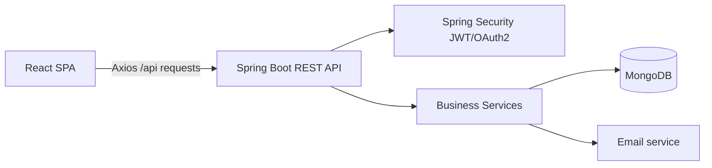

# SkillSwap Backend Architecture and Interview Q&A

## Project Resume Context

SkillSwap – Service Marketplace Platform  
Full Stack Web Application

- Built a full stack service marketplace with React and Spring Boot, implementing clean MVC architecture with RESTful APIs and a responsive component-based frontend.
- Secured the platform with stateless JWT authentication, access/refresh tokens, and OAuth2 social login (Google, GitHub) using Spring Security, with Axios interceptors for automatic token refresh.
- Implemented role-based access control (USER, PROVIDER, ADMIN) with a 6-state booking lifecycle and an automated review aggregation engine that recalculates service and provider ratings in real time.

## Important Resume Accuracy

The code supports JWT access and refresh tokens, but refresh-token rotation is currently client-side only. The refresh endpoint generates a new refresh token but does not store, revoke, or compare refresh tokens against a server-side record.

The booking model defines six statuses, but strict state-transition rules are not currently enforced. The backend accepts a requested enum status and saves it. A production implementation should validate allowed transitions and restrict them by actor role.

## SkillSwap Overall Architecture

SkillSwap is a two-tier application:



- Frontend: React 18, React Router, Vite, Tailwind CSS, Axios
- Backend: Spring Boot 3.2, Java 21
- Database: MongoDB through Spring Data MongoDB
- Authentication: JWT access/refresh tokens, Google/GitHub OAuth2
- Communication: REST/JSON APIs under `/api`
- Development servers: frontend on port `3000`, backend on port `8080`
- Vite proxies `/api` and `/oauth2` requests to Spring Boot

## Frontend Structure

The frontend is the user-facing layer.

### Application Shell

`App.jsx` defines:

- Browser routing
- Public routes such as services and provider profiles
- Guest-only routes such as login and registration
- Protected routes such as bookings, messages, and dashboards
- `ProtectedRoute` and `GuestRoute` access guards
- Global authentication through `AuthProvider`
- Global toast notifications

### Pages

Pages represent complete user workflows:

- `HomePage.jsx`
- `ServicesPage.jsx`
- `ServiceDetailPage.jsx`
- `BookingsPage.jsx`
- `MessagesPage.jsx`
- `ProfilePage.jsx`

They coordinate data loading, user interaction, and page-level state.

### Components

Reusable UI is split into feature areas:

- `components/services`: service cards and reviews
- `components/booking`: booking presentation
- `components/profile`: profile UI
- `components/common`: navbar, footer, ratings
- `components/auth`: authentication-specific UI

This is effectively the frontend View layer, although React components also contain presentation-oriented controller logic such as event handlers and API calls.

### Client API Layer

`frontend/src/utils/api.js` centralizes REST calls:

```text
authApi     -> /api/auth/*
userApi     -> /api/users/*
serviceApi  -> /api/services/*
bookingApi  -> /api/bookings/*
reviewApi   -> /api/reviews/*
messageApi  -> /api/messages/*
```

It also:

1. Reads the JWT from `localStorage`.
2. Adds it as a `Bearer` token to every request.
3. Attempts refresh-token recovery on HTTP `401`.
4. Redirects to login if refreshing fails.

`AuthContext.jsx` restores the current user on startup, exposes login/register/logout methods, and provides role helpers such as `isProvider` and `isAdmin`.

## Backend MVC Structure

The backend follows a layered REST version of MVC:

```text
HTTP request
    |
Controller
    |
DTO validation
    |
Service / business logic
    |
Repository
    |
MongoDB
```

### Model

The `model` package contains MongoDB documents and domain state:

- `User.java`
- `Service.java`
- `Booking.java`
- `Review.java`
- `Message.java`

For example, `Service.java` represents a marketplace listing with provider information, title and description, category and tags, price and pricing type, images and features, rating and booking counters, active/status flags, and timestamps.

`@Document` maps these classes to MongoDB collections, while `@CreatedDate` and `@LastModifiedDate` provide auditing.

### DTOs

The `dto` package defines request and response shapes:

- `AuthDto.java`
- `ServiceDto.java`
- `BookingDto.java`
- `ReviewDto.java`
- `UserDto.java`

DTOs are especially important for incoming data. For example, `CreateServiceRequest` uses validation annotations such as `@NotBlank`, `@NotNull`, and `@Positive`.

### Controllers

Controllers are the HTTP-facing part of the backend:

- `AuthController.java`
- `UserController.java`
- `ServiceController.java`
- `BookingController.java`
- `ReviewController.java`
- `MessageController.java`

They are responsible for mapping URLs and HTTP methods, reading path/query/body parameters, obtaining the authenticated user, calling a service, and returning HTTP status codes and JSON responses.

### Services

The `service` package owns application logic:

- `AuthService`
- `UserService`
- `ServiceService`
- `BookingService`
- `ReviewService`
- `MessageService`

For creating a service:

1. `ServiceController` receives `POST /api/services`.
2. Spring validates `CreateServiceRequest`.
3. The controller extracts the authenticated user's email.
4. `ServiceService` loads the user.
5. It promotes the user to provider status.
6. It constructs a `Service` model.
7. It persists the model using `ServiceRepository`.
8. The controller returns HTTP `201 Created`.

The service layer also checks ownership. Updating or deleting a service requires that the authenticated user owns the service.

### Repositories

Repositories abstract database access:

- `UserRepository`
- `ServiceRepository`
- `BookingRepository`
- `ReviewRepository`
- `MessageRepository`

`ServiceRepository` extends `MongoRepository`, giving the application standard CRUD operations. It also defines derived queries and custom MongoDB queries for active services, category filtering, provider filtering, keyword search, pagination, and sorting.

## Example Service Detail and Booking Flow

A typical user journey is:

```text
ServiceDetailPage
    -> serviceApi.getById(id)
    -> GET /api/services/{id}
    -> ServiceController
    -> ServiceService
    -> ServiceRepository
    -> MongoDB
```

When the user books the service:

```text
ServiceDetailPage
    -> bookingApi.create(...)
    -> POST /api/bookings
    -> BookingController
    -> BookingService
    -> BookingRepository
    -> MongoDB
```

`ServiceDetailPage.jsx` loads the service and reviews in parallel. The booking sidebar collects a schedule date and notes, then sends the booking request.

`BookingController.java` uses `@AuthenticationPrincipal` to ensure the booking is associated with the authenticated user.

## Authentication and Security

`SecurityConfig.java` configures:

- Stateless sessions
- JWT authentication
- CORS for the frontend
- BCrypt password hashing
- Public authentication endpoints
- Public service/review GET endpoints
- Admin-only endpoints
- OAuth2 login
- The JWT filter before Spring's username/password filter

The security flow is:

```text
Login form
    -> POST /api/auth/login
    -> AuthService
    -> AuthenticationManager
    -> BCrypt password verification
    -> JWT and refresh token
    -> React localStorage
    -> Bearer token on later requests
```

JWT implementation is located in:

- `JwtAuthenticationFilter.java`
- `JwtUtils.java`
- `UserDetailsServiceImpl.java`

OAuth2 success handling is implemented by `OAuth2AuthenticationSuccessHandler`.

## Application Startup

`SkillSwapApplication.java` starts Spring Boot and enables:

- MongoDB auditing
- Asynchronous operations
- Component scanning for controllers, services, repositories, and security classes

## Top 50 Backend Interview Questions and Answers

### Architecture and MVC

#### 1. What architecture did you use?

SkillSwap uses a React frontend and Spring Boot REST backend. The backend follows a layered architecture:

```text
Controller -> Service -> Repository -> MongoDB
```

Spring Security operates across the request pipeline, and React consumes the backend's JSON responses.

#### 2. How does MVC apply to this project?

The model is represented by MongoDB document classes such as `User`, `Service`, `Booking`, `Review`, and `Message`. Spring REST controllers act as controllers, while React pages and components provide the view layer. The service layer contains business logic between controllers and repositories.

#### 3. Why did you separate controllers and services?

Controllers focus on HTTP concerns such as routing, request parsing, validation, and response status codes. Services contain business rules, authorization checks, entity creation, and coordination between repositories. This improves maintainability and testability.

#### 4. What is the request flow for creating a service?

```text
React form
-> POST /api/services
-> ServiceController
-> ServiceService
-> UserRepository and ServiceRepository
-> MongoDB
```

The controller validates the request and identifies the authenticated user. The service applies business logic and persists the service.

#### 5. What is the purpose of the DTO layer?

DTOs define the input and output contract of the API. For example, `CreateServiceRequest` contains only fields allowed when creating a service and applies validation using `@NotBlank`, `@NotNull`, and `@Positive`.

#### 6. Why not directly expose entities as API responses?

Directly exposing entities can reveal internal fields, create tight coupling between persistence and API contracts, and make future schema changes harder. A production improvement would be to consistently map entities to response DTOs instead of returning entities directly in several controllers.

#### 7. What does `@RestController` do?

`@RestController` combines `@Controller` and `@ResponseBody`. It tells Spring that the class handles HTTP requests and that return values should be serialized, usually as JSON.

#### 8. What does `@RequestMapping("/api/services")` do?

It defines a common URL prefix for all methods in `ServiceController`. For example, a method annotated with `@GetMapping("/{id}")` handles `GET /api/services/{id}`.

#### 9. How is request validation implemented?

The controller uses `@Valid` on request bodies, and DTO fields contain Jakarta validation annotations. Invalid input is rejected by Spring's validation mechanism before normal business logic executes.

#### 10. What would you improve in the error-handling design?

I would add a global `@RestControllerAdvice` exception handler. Currently, many controllers catch broad `Exception` types and return `400 Bad Request`. A centralized handler could produce consistent responses for validation errors, not-found errors, authorization failures, and unexpected server errors.

### Spring Boot and MongoDB

#### 11. Why did you choose MongoDB?

SkillSwap has flexible marketplace documents containing arrays such as tags, features, and images. MongoDB's document model maps naturally to these structures and supports rapid schema evolution.

#### 12. What does `MongoRepository` provide?

`MongoRepository` provides CRUD operations, pagination, sorting, and query integration. For example, `ServiceRepository` inherits methods such as `findById` and `save`.

#### 13. How do derived queries work?

Spring Data derives queries from method names. For example:

```java
findByProviderIdAndActiveTrue(String providerId)
```

is translated into a MongoDB query filtering by provider ID and `active = true`.

#### 14. How does service searching work?

`ServiceRepository` uses a custom MongoDB query with case-insensitive regular expressions against the title, description, and tags. Results are paginated and sorted by rating or creation date.

#### 15. How is pagination implemented?

Controllers accept `page` and `size` query parameters. Services create a `PageRequest` with sorting, then pass it to the repository. MongoDB returns a Spring `Page` containing content and pagination metadata.

#### 16. What is the purpose of `@Document`?

`@Document(collection = "services")` maps a Java class to a MongoDB collection. The `Service` model is stored in the `services` collection.

#### 17. What does `@Id` represent?

`@Id` identifies the document's primary key. In this project, MongoDB document IDs are represented as strings.

#### 18. What does MongoDB auditing provide?

`@EnableMongoAuditing` enables automatic population of fields annotated with `@CreatedDate` and `@LastModifiedDate`. This is used on models such as `User`, `Service`, and `Booking`.

#### 19. Why is the user email indexed uniquely?

The email field has `@Indexed(unique = true)`. This prevents duplicate accounts from being created with the same email at the database level.

#### 20. What database improvement would you make?

I would add indexes for frequently queried fields such as `Service.providerId`, `Service.category`, `Service.active`, `Booking.clientId`, `Booking.providerId`, `Review.serviceId`, and `Review.providerId`. This would improve filtering and lookup performance as the data grows.

### Authentication and JWT

#### 21. How does login work?

The client sends credentials to `POST /api/auth/login`. `AuthService` delegates authentication to Spring's `AuthenticationManager`. If authentication succeeds, the backend creates an access token and refresh token and returns them with user information.

#### 22. How is the password verified?

Passwords are encoded with `BCryptPasswordEncoder` during registration. During login, Spring Security compares the submitted password with the stored BCrypt hash.

#### 23. Why use BCrypt?

BCrypt is a deliberately slow, salted password-hashing algorithm. It makes brute-force attacks more expensive than storing plaintext passwords or using a fast hash such as SHA-256 directly.

#### 24. What information is stored in the JWT?

The current token contains the user's email as the subject, along with issued-at and expiration timestamps. It is signed using an HMAC secret key.

#### 25. How does the JWT filter work?

`JwtAuthenticationFilter` runs once per request. It reads the `Authorization` header, extracts the token after `Bearer`, verifies the token signature and expiration, loads the user by email, and places an authenticated principal into `SecurityContextHolder`.

#### 26. Why are sessions configured as stateless?

With stateless sessions, the server does not maintain an HTTP session for each user. Each request carries its authentication token. This is suitable for REST APIs and supports horizontal scaling more easily.

#### 27. What is the difference between an access token and a refresh token?

The access token is short-lived and used to access protected APIs. The refresh token has a longer lifetime and is used to obtain a new access token after expiration.

#### 28. Does this project implement secure server-side refresh-token rotation?

Not fully. The refresh endpoint validates the refresh token's signature and expiration, then generates a new access token and refresh token. However, refresh tokens are not stored or revoked server-side. A stronger implementation would persist a token family or token identifier and invalidate the old token after use.

#### 29. How does automatic token refresh work?

The frontend Axios response interceptor detects a `401` response. It sends the stored refresh token to `/api/auth/refresh`, stores the returned tokens, adds the new access token to the original request, and retries it.

#### 30. What happens if refresh fails?

The frontend clears local storage and redirects the user to `/login`.

#### 31. Where should the JWT secret be stored?

It should be stored in environment variables or a secret manager such as Azure Key Vault, not committed to `application.properties`. The current configuration contains sensitive-looking OAuth credentials and should be rotated if they are real.

#### 32. What are weaknesses of storing JWTs in local storage?

JavaScript can access local storage, so an XSS vulnerability could expose the tokens. A stronger design often uses secure, `HttpOnly`, `SameSite` cookies, combined with appropriate CSRF protection.

### OAuth2 and Authorization

#### 33. How does OAuth2 login work?

The user authenticates with Google or GitHub through Spring Security OAuth2. After successful authentication, `OAuth2AuthenticationSuccessHandler` reads provider attributes, creates or updates the local user, generates a JWT, and redirects the browser to the frontend callback URL.

#### 34. How are Google and GitHub users identified?

The handler reads provider-specific attributes such as `sub`, `login`, `email`, `name`, and avatar fields. It determines the provider and looks up the local user by email.

#### 35. What happens for a first-time OAuth2 user?

A new local `User` document is created with the provider email, display name, avatar, provider name, `ROLE_USER`, and verified email status.

#### 36. What is role-based access control in SkillSwap?

The user model supports:

```text
ROLE_USER
ROLE_PROVIDER
ROLE_ADMIN
```

Spring Security restricts admin endpoints to `ROLE_ADMIN`. Provider privileges are also enforced through ownership checks in service-layer methods.

#### 37. How does the application protect admin endpoints?

`SecurityConfig` contains:

```java
.requestMatchers("/api/admin/**").hasRole("ADMIN")
```

Only authenticated users with the admin role can access those routes.

#### 38. How are service ownership checks enforced?

When updating or deleting a service, `ServiceService` compares the authenticated user's ID with the service's `providerId`. If they do not match, it throws an authorization error.

#### 39. Is checking ownership only in the frontend sufficient?

No. Frontend checks are only for user experience. Authorization must be enforced on the backend because clients can bypass or modify frontend code. SkillSwap correctly performs important ownership checks in the service layer.

#### 40. How is CORS configured?

CORS is configured in `SecurityConfig`. The allowed frontend origin comes from `app.cors.allowedOrigins`, and allowed methods include `GET`, `POST`, `PUT`, `PATCH`, `DELETE`, and `OPTIONS`.

### Services, Bookings, and Reviews

#### 41. What happens when a user creates a service?

The backend loads the authenticated user, adds `ROLE_PROVIDER` to the user's roles, copies provider information into the service, initializes rating, review count, and booking count, marks the service active, and saves it in MongoDB.

#### 42. Why copy provider information into the service document?

Copying provider name, avatar, and rating makes service listing responses faster because the API does not need to join user data for every result. The tradeoff is possible stale duplicated data when the provider later changes their profile.

#### 43. What are the booking states?

The `BookingStatus` enum contains six states:

```text
PENDING
CONFIRMED
IN_PROGRESS
COMPLETED
CANCELLED
DISPUTED
```

The booking also has an independent payment status:

```text
PENDING
PAID
REFUNDED
FAILED
```

#### 44. How is a booking created?

The backend loads the client and service, prevents users from booking their own service, copies relevant service and client details into the booking, sets the initial status to `PENDING`, and saves it.

#### 45. How are bookings restricted to the correct users?

For booking details and status updates, the service checks whether the authenticated user is either the booking's client or provider. Unrelated users receive an authorization failure.

#### 46. Does the current code enforce valid booking transitions?

Not strictly. It accepts the requested enum status and saves it. A stronger implementation would define valid transitions, for example:

```text
PENDING -> CONFIRMED
CONFIRMED -> IN_PROGRESS
IN_PROGRESS -> COMPLETED
PENDING -> CANCELLED
```

It should also restrict which actor can perform each transition.

#### 47. How does review creation work?

A review can be created only when the booking exists, the authenticated user is the booking's client, the booking status is `COMPLETED`, and no review already exists for that booking. The review is then saved and the booking is marked as reviewed.

#### 48. How are service ratings calculated?

After a review is created, the service retrieves reviews, filters them for the relevant service, calculates the arithmetic mean, rounds it to one decimal place, updates the service rating, updates the review count, and saves the service.

#### 49. How are provider ratings calculated?

The backend retrieves all reviews for the provider, calculates the average rating, rounds it to one decimal place, updates the provider's rating and review count, and saves the user.

#### 50. What improvements would you make before production?

I would prioritize:

- Add global exception handling with `@RestControllerAdvice`.
- Enforce valid booking-state transitions.
- Restrict booking status changes by client/provider role.
- Implement server-side refresh-token rotation and revocation.
- Use response DTOs consistently.
- Add database indexes for common queries.
- Add unit and integration tests.
- Use environment variables or a secret manager for credentials.
- Improve review aggregation with database aggregation queries instead of loading all provider reviews into memory.
- Add transactions or compensating logic for multi-document operations.
- Add rate limiting and stronger validation for public endpoints.

## Final Interview Summary

I built SkillSwap as a layered Spring Boot REST API backed by MongoDB. Controllers handle HTTP and validation, services contain marketplace and authorization rules, and repositories encapsulate persistence. Security is stateless and uses Spring Security with JWT authentication, refresh tokens, OAuth2 login, BCrypt passwords, and role-based authorization. The main domain flows are service creation, provider ownership, booking lifecycle management, and review-driven rating recalculation.
